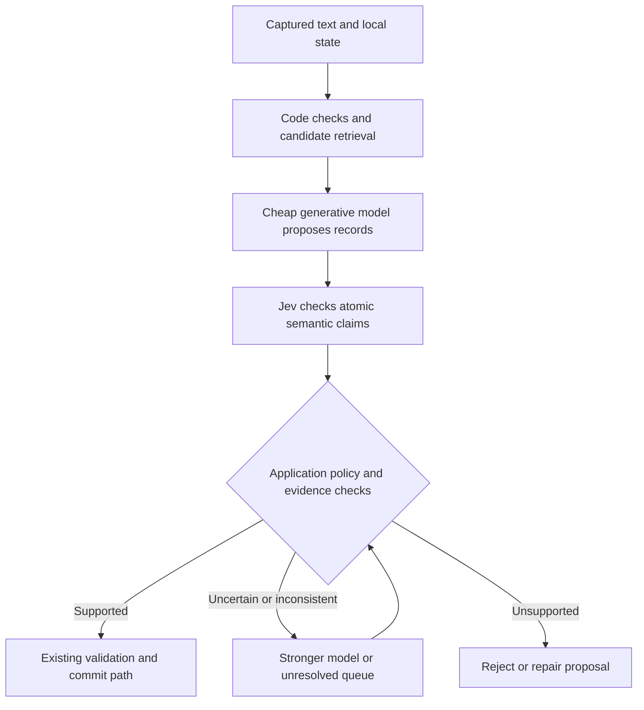

**Jev / machine-native decision models: fit for SuperTwin**

Research date: 19 September 2026. Recommendation based on the current repository and public documentation; no paid inference, private-data upload, or runtime integration was performed.

**Recommendation**

Jev is worth evaluating for SuperTwin's semantic verification and bounded classification work. The strongest use is checking whether proposed memories, space assignments, and task updates are actually supported by their sources. A cheap generative model can produce the records; Jev can evaluate specific failure conditions; uncertain cases can go to a stronger model. This could let us use cheap generation more widely while retaining quality.

It cannot replace the complete understanding pipeline. Many existing JSON responses contain newly written summaries, claims, task descriptions, entity names, and plans. Structured JSON does not make those outputs closed-answer decisions.

There is also no blanket price advantage over the DeepSeek version in our strategy. With the strategy's cached-input assumptions, DeepSeek V4 Flash 0731 costs about $0.73 per user-month for the illustrative workload, versus $1.21 for the same input volume through Jev. These are token-cost comparisons, not interchangeable-capability forecasts.

Start with a shadow evaluation of the semantic Critic. Use business-stream tiering as a small integration exercise if desired. Consider space matching and extraction verification next. Defer a learned model router until we have outcomes from our actual provider/model combinations.

**What Jev does and how it works**

The service accepts a shared `state` and a map of typed `questions`. State can contain messages, candidate records, reference material, and relevant user preferences. Each question evaluates that state independently. Code combines the returned values and owns subsequent actions. This is a useful interface for semantic decisions inside a larger program. [Introduction](https://docs.typesafe.ai/introduction), [State](https://docs.typesafe.ai/concepts/state).

| Primitive | Meaning | SuperTwin example |
| --- | --- | --- |
| Choice | Select one supplied option; return its distribution and confidence | Existing space ID, `none`, or `unclear`; proposed-record verdict |
| Noul | Return a 0–1 yes-probability for one proposition | Does this message establish that this task was completed? |
| Score | Return an expected position on an ordered rubric | Relevance from unrelated through directly answering |

Choice supports up to 255 options. Score uses 2–10 ordered levels; it is not an arbitrary numeric extractor or exact calculator. Noul 0.5 means uncertainty about a proposition, not a medium amount of a property. [Choice](https://docs.typesafe.ai/primitives/choice), [Score](https://docs.typesafe.ai/primitives/score), [Noul](https://docs.typesafe.ai/primitives/noul).

TypeSafe describes a model architecture, parallel sampling, and reinforcement learning for calibrated decisions, or RLCD. The claimed speed comes from evaluating structured decisions without generating a prose answer token by token. The launch claims 70–500 ms end-to-end latency in its test environment. Public documentation does not provide enough implementation detail to independently assess the underlying training or architecture. Treat latency and quality claims as vendor evidence until measured on our workload. [Launch article](https://typesafe.ai/blog/introducing-system-one-models-and-jev).

Important request semantics:

- Question IDs are routing labels, invisible to the model. Instructions must explicitly identify the item or state path being evaluated.
- Heads share state but do not read one another's answers. A dependent decision needs another request, or speculative questions for every relevant candidate followed by code selecting the applicable result.
- Choice is relative to the supplied alternatives. Include `none` or `unclear`; additionally test absolute fit when all candidates might be wrong. Use separate membership questions when multiple spaces can legitimately apply.
- Batch questions that share relevant context. This avoids repeatedly paying for the same state, but question text still contributes input tokens. Large irrelevant state can hurt accuracy.
- Confidence, top-option probability, and observed accuracy are different quantities. Per-head thresholds need validation; combining several confident heads does not establish a calibrated joint success probability.

Sources: [Advanced structure](https://docs.typesafe.ai/primitives/advanced), [Speculative fan-out](https://docs.typesafe.ai/patterns/fan-out), [Confidence](https://docs.typesafe.ai/confidence), [How to build](https://docs.typesafe.ai/concepts/how-to-build-with-system-one).

**Where it fits in the current code**

| Priority | Work | Proposed Jev role | Boundary / practical value |
| --- | --- | --- | --- |
| 1 | Semantic Critic | Check support, subject, overlap, source-to-claim meaning, and completion evidence | Strong fit; existing separate inference step offers a measurable replacement opportunity |
| 2 | Extraction verification | Check each proposed field or claim, including omissions | Makes cheap generation more usable; preserve exact evidence and typed validation |
| 3 | Existing-space matching | Score retrieved candidates; select an ID or no match | Good bounded decision; new-space names and goals still need a writer |
| 4 | Business-stream tiering | Choose among allowed tiers and reason codes | Easiest small integration; limited savings because results are cached |
| 5 | Retrieval evidence checks | Identify answering passages, contradictions, and unsupported citations | Useful selectively after local retrieval; current judge also writes an answer |
| 6 | Tool/recipe selection | Select from currently available tools or saved recipes | Appropriate for bounded actions and candidate arguments; execution remains separately controlled |
| 7 | Model routing / personalization | Semantic features for a learned predictor, or post-generation verification | Potentially useful after labeled outcomes exist; not an immediate general-purpose router |

**1. Semantic Critic: the best substantive pilot.** The existing [Critic](/Users/adityakatare/Documents/SuperTwinV13/worker/src/brain/critic.ts:446) already evaluates proposed items before commit. Its verdicts include commit, reject, downgrade to unsorted, and flag overlap. Keep the existing mechanical checks and commit validation, and evaluate whether Jev can supply the semantic part.

For each proposal, ask narrow questions: Does the quoted source support this meaning? Is the subject actually this person? Is the purported completion an accomplished event rather than a future intention? Does this new-space proposal duplicate one of the retrieved spaces? Use explicit reason codes and deterministic explanation templates when the current contract needs text. An overlap ID must come from supplied candidates.

There is a specific integration hazard: [verdictFor](/Users/adityakatare/Documents/SuperTwinV13/worker/src/brain/critic.ts:99) currently treats an omitted item as commit. A new Jev adapter must validate that every expected answer exists before constructing a Critic result. A timeout, skipped answer, or malformed result must trigger fallback/defer behavior, never become an omitted approval. This is a design requirement for the proposed adapter, not a runtime change made by this research.

**2. Extraction: generate first, verify fields.** [extract-pass.ts](/Users/adityakatare/Documents/SuperTwinV13/worker/src/brain/extract-pass.ts) produces open-ended claims and relationships with evidence. Jev can verify whether a candidate field is wrong, belongs to the wrong person, lacks support, or wrongly omits an explicit value. Ask about individual fields rather than one broad “is this entire record correct?” question. TypeSafe's [SDE cascade](https://docs.typesafe.ai/cookbooks/sde_cascade) demonstrates cheap extraction followed by Jev checks and escalation.

For readily parsed values, first extract candidate email addresses, amounts, dates, and phone spans with code; let Jev choose among candidates plus `none`; then copy and normalize the original span. This preserves provenance and avoids needing generated text. It does not solve unrestricted entity-name or narrative extraction. [Pre-parsed value extraction](https://docs.typesafe.ai/cookbooks/pre_parsed_value_extraction_cookbook).

**3. Space assignment and duplicate detection.** [orient.ts](/Users/adityakatare/Documents/SuperTwinV13/worker/src/brain/orient.ts) mixes decisions with writing. Retrieve a short candidate list locally, then evaluate relevance against each candidate's goal and evidence. A no-match result means unmatched, not automatic permission to create a new space. A later generative step can write the title, goal, and episode summary. Missing the correct space during retrieval cannot be repaired by a closed-choice model.

**4. Stream tiering.** [tiering.ts](/Users/adityakatare/Documents/SuperTwinV13/worker/src/tiers/tiering.ts:294) uses one cached classification call for a particular unresolved business-sender case; most tiering is already code. Its small enum and fallback behavior make this a low-impact integration exercise. Do not project its savings across all streams or every event.

**5. Grounded search.** The active path uses [planViaModel](/Users/adityakatare/Documents/SuperTwinV13/worker/src/grounded/bar.ts:178) and [route.v1](/Users/adityakatare/Documents/SuperTwinV13/worker/src/prompts/route.v1.ts). It selects among nine classes and five retrieval methods, but also generates entities, seeds, and time/filter fields. Jev can choose classes, methods, completeness, and existing candidate IDs. Deterministic parsers can resolve supported date forms. Unbounded search terms and ambiguous planning still require the current writer or another generator.

The older four-way [routeViaModel](/Users/adityakatare/Documents/SuperTwinV13/worker/src/grounded/router.ts:31) is not the default planner invoked by the active bar. Replacing that helper alone would not deliver the supposed production routing win.

The [retrieval judge](/Users/adityakatare/Documents/SuperTwinV13/worker/src/grounded/bar.ts:199) returns evidence selections and a newly written short answer. Jev could select pre-segmented passage/quote IDs, classify contradictions, and check support. Code can copy exact quotes. A generator still writes the answer. Preserve contradictory evidence where it matters rather than filtering it out as irrelevant. [RAG passage classification](https://docs.typesafe.ai/cookbooks/classifying_rag_passages), [Citation checking](https://docs.typesafe.ai/cookbooks/citation_check).

**6. Tool and recipe selection.** Given a vetted candidate set, Jev could select a reusable workflow and bounded arguments such as an existing task ID or action enum. Arbitrary recipient strings, new URLs, and message bodies need parsers or generation. A semantic match never supplies authorization to execute. This is an additional executor optimization to evaluate, not a replacement for planning, tool validation, or browser perception. [Function calling](https://docs.typesafe.ai/cookbooks/function_calling), [Skill suggestion](https://docs.typesafe.ai/cookbooks/skill_suggestion).

**What should remain elsewhere**

- Summary writing, digest lines, new claims, new space titles/goals, task plans, user-facing answers, and messages: generative models. See [Orient](/Users/adityakatare/Documents/SuperTwinV13/worker/src/brain/orient.ts), [Decide](/Users/adityakatare/Documents/SuperTwinV13/worker/src/brain/decide-pass.ts), [Digest](/Users/adityakatare/Documents/SuperTwinV13/worker/src/brain/digest-pass.ts), and [Next-step](/Users/adityakatare/Documents/SuperTwinV13/worker/src/brain/next-step.ts).
- Exact counts, date arithmetic, money arithmetic, quote matching, identity keys, schedules, permissions, and side effects: deterministic code.
- The [closure timer](/Users/adityakatare/Documents/SuperTwinV13/worker/src/brain/closure-check.ts:1): already lookup-first and explicitly does not call a model. Evaluate evidence in the understanding pass; do not add Jev to every timer tick.
- The [surface router](/Users/adityakatare/Documents/SuperTwinV13/worker/src/surfaces/router.ts:1): already implements product rules for where and in what order to surface work. Do not turn deterministic routing into paid inference.
- The [local reranker](/Users/adityakatare/Documents/SuperTwinV13/worker/src/retrieval/reranker.ts:1): already avoids an API charge. Compare accuracy and total latency before adding a hosted semantic rerank.
- Screenshot, audio, and video interpretation: existing perception/transcription components; Jev consumes their text outputs.

The strategy promises that routing/classification stays local and that cloud understanding uses zero-retention providers. Hosted Jev would need to be an explicitly defined cloud understanding/verification option, or a deliberate strategy revision. It is not equivalent to an on-device model. [Strategy §10](/Users/adityakatare/Documents/SuperTwinV13/SuperTwin_Product&Strategy_V1.md:756).

**Economics: cheaper than which DeepSeek?**

Prices checked on 19 September 2026, USD per million tokens. Jev lists $0.042 input and free output; no separate cached-input price is published. The precise older OpenRouter variant in our strategy still lists $0.04 input / $0.08 output, with a provider cache-read price of $0.008. Direct DeepSeek's current Flash model has different prices and peak/off-peak rates. Provider/version choice matters. [Jev pricing](https://docs.typesafe.ai/models), [OpenRouter V4 Flash 0731](https://openrouter.ai/deepseek/deepseek-v4-flash-0731), [Direct DeepSeek pricing](https://api-docs.deepseek.com/quick_start/pricing/).

| Model / scenario | Fresh input | Cached input | Output | Monthly illustration |
| --- | ---: | ---: | ---: | ---: |
| Jev | $0.042 | $0.042 assumed | $0 | $1.2096 |
| DeepSeek V4 Flash 0731, cache realized | $0.040 | $0.008 | $0.080 | $0.7296 |
| Same V4 Flash, no cache hits | $0.040 | $0.040 | $0.080 | $1.3440 |
| Direct V4.1 Flash, off-peak | $0.150 | $0.003 | $0.600 | $2.9376 |
| Direct V4.1 Flash, peak | $0.300 | $0.006 | $1.200 | $5.8752 |

The illustration uses the [strategy's workload](/Users/adityakatare/Documents/SuperTwinV13/SuperTwin_Product&Strategy_V1.md:794): 160 calls/day × 30 days, with 2,000 fresh input tokens, 4,000 cache-hit tokens, and 500 generated output tokens per call. Jev is charged for all 6,000 input tokens and has no output charge. The no-cache row bills all 6,000 DeepSeek input tokens at its fresh-input rate. Table arithmetic was checked programmatically.

This deliberately normalizes input volume. It does not mean Jev could perform all 4,800 understanding calls, nor that tokenizer counts, question overhead, quality, caching eligibility, or latency would be identical. Cached token prices require actual cache hits. Enterprise retention terms or a pinned provider can also change available economics.

Under this illustration Jev is about 66% more expensive than cached V4 Flash 0731, and 10% cheaper than the same model without caching. It is substantially cheaper than direct V4.1 Flash at the listed rates. These comparisons are much narrower than the launch's cross-workflow multipliers.

A 2,000-token Jev request costs $0.000084; 1,000 such requests cost $0.084. At 6,000 tokens the latter is $0.252. Independent questions about shared state should be batched, but they are not unlimited free work: their instructions and criteria add tokens.

Use these equations on observed run data:

```text
C_jev = 0.042 × (state tokens + all question tokens) / 1,000,000
C_llm = (fresh tokens × fresh price
       + cache-hit tokens × cache price
       + generated tokens × output price) / 1,000,000

C_cascade = C_cheap_generator + C_jev + escalation_rate × C_strong
```

Add retries, repairs, and any repeated context to the last equation. Compared with always using the strong model, the simplified cascade saves money when `escalation_rate < 1 - (C_cheap_generator + C_jev) / C_strong`, assuming comparable accepted-output quality. Adding Jev without removing another call or reducing failures/escalations increases spend. For subscription-backed providers, fewer calls may preserve quota and latency without lowering the subscription bill.

**Predictive routing: useful, but a different problem**

There are three separate decisions:

1. Task routing: choose a retrieval strategy, handler, or skill. Jev directly supports this when options are bounded.
2. Model routing before generation: predict whether a cheaper eligible model will produce an acceptable result. This needs evidence about that model's performance on our tasks.
3. Verification after generation: inspect a concrete answer and escalate when its evidence is insufficient. This is the most grounded starting point for SuperTwin.

[RouteLLM](https://github.com/lm-sys/RouteLLM) learns routing from preference/outcome data rather than merely asking an LLM to describe a task as easy or difficult. Its public implementations target strong/weak model tradeoffs; some require an embedding API, so “local router” does not automatically mean no external dependency. Published benchmark savings do not establish performance for our provider pairs or personal-memory tasks. [Research paper](https://arxiv.org/abs/2406.18665).

For us, first select eligible models in code using modality, context length, privacy, available credentials, quota, and budget. Begin with fixed per-step choices and a measured fallback path. Log accepted/corrected outcomes. Later train or calibrate a router using task class, evidence completeness, context size, language, novelty, and prior outcomes. Jev could produce semantic features, but local embeddings or existing metadata may be cheaper and sufficient.

Do not treat Jev's confidence in its own choice of “DeepSeek” as the probability that DeepSeek's unseen future answer will be correct. A router needs a target defined by actual downstream success.

For future preference or nudge-quality prediction, the [feature-discovery cookbook](https://docs.typesafe.ai/cookbooks/autoresearch_feature_discovery) shows another option: use Jev to produce semantic features, then train a separate conventional model on real outcomes. That would personalize the downstream predictor, not fine-tune Jev. Temporal/user-separated evaluation is necessary to avoid learning from the same examples later used to claim success.

**Integration shape**



For closed classification, B can call Jev directly without C. The existing [provider contract](/Users/adityakatare/Documents/SuperTwinV13/worker/src/providers/types.ts) is geared to generation/tool transport. Add a distinct `DecisionProvider` capability rather than pretending every pipeline prompt can run through Jev. Integrate it with the [admission gate](/Users/adityakatare/Documents/SuperTwinV13/worker/src/providers/gate.ts), cost ledger, kill switch, tracing, and immutable per-call selection.

The service uses `POST https://api.typesafe.ai/v1/systemone` with bearer authentication. The SDK package is `@typesafe-ai/sdk`; initialize it with the account's API key and send state plus typed questions. Illustrative worker-side TypeScript, based on the current SDK; not installed, executed, or production-ready. [API reference](https://docs.typesafe.ai/api).

```ts
import { choice, noul, TypeSafeClient } from "@typesafe-ai/sdk";

const client = new TypeSafeClient({
  apiKey: process.env.TYPESAFE_API_KEY,
  defaultModel: "jev-1.13.0",
  timeout: 1500,
  retry: { maxRetries: 0 }, // Our gate must account for physical attempts.
  logLevel: "warn",
});

const result = await client.systemOne({
  state: {
    source: {
      speaker_id: "person_b",
      text: "I will pay the villa deposit tonight.",
    },
    proposal: {
      subject_id: "person_b",
      claim: "The villa deposit has been paid.",
    },
  },
  questions: {
    supported: noul(
      "Does state.source establish state.proposal.claim as an accomplished event?"
    ),
    event_status: choice("What payment status does state.source establish?", {
      completed: "The payment has already happened.",
      promised: "A future payment is intended or promised.",
      unclear: "Neither status is established.",
    }),
  },
}, { signal: AbortSignal.timeout(2000) });

// Validate every required answer. Record scores for a shadow evaluation.
// Application policy decides whether to reject, defer, or run another model.
// No universal confidence threshold or automatic side effect is implied here.
const observations = result.answers;
```

The synthetic example should be labeled unsupported/promised by our evaluation; no Jev output for it was measured. The two questions independently inspect the same source. The application must check their consistency rather than assuming one answer constrained the other.

The JS SDK supports our Node runtime. Its debug logging includes unredacted bodies; do not enable it for private state. Timeout is per attempt, so add a total deadline. SDK retries must not create untraced extra provider attempts. Use the worker, not the UI, to hold the API key. [JavaScript SDK](https://docs.typesafe.ai/sdk/javascript), [Client options](https://docs.typesafe.ai/sdk/javascript/api/interfaces/TypeSafeClientConfig), [Request options](https://docs.typesafe.ai/sdk/javascript/api/interfaces/RequestOptions), [Retry policy](https://docs.typesafe.ai/sdk/javascript/api/interfaces/RetryPolicy).

Pin `jev-1.13.0` during evaluation. Current documented limits are 64k tokens for the complete request and 32k for state plus the longest question. Inputs are text only. English has the strongest support. No customer-specific fine-tuning is offered. Rate limits are presently described as changeable. [Models](https://docs.typesafe.ai/models). One general primitives page still describes a 32k shared budget; use the specific model contract and verify limit behavior during integration.

Cache only against the complete relevant state, rubric/prompt version, model version, and user-preference version. A cached decision about an older task state must not become evidence about its current state.

**Reliability and retention limits that matter here**

Type-safe output prevents unsupported output shapes; it does not prevent an incorrect valid answer. The documented weaknesses include literal interpretation, negation/scope mistakes, numerical reasoning, distraction from irrelevant context, adversarial inputs, and inconsistent answers across related questions. Keep arithmetic, consistency invariants, provenance checks, and authority in code. [Jev jaggedness](https://docs.typesafe.ai/model-jaggedness/jev-1.13).

Consequently, Jev is not a sole prompt-injection defense, permission checker, or factual truth oracle. Our observed/captured text remains data even when it contains instructions. A model's acceptance cannot authorize sending a message or changing a financial commitment. This follows our existing product boundaries; it is not a proposal for a new approval flow.

TypeSafe says customer requests and responses are not used for training. Zero data retention is separately offered for enterprise customers; ordinary access does not establish it. The public DPA describes retention according to purpose and applicable requirements, rather than a universal zero-retention term. Before processing private SuperTwin content, confirm that the specific account/contract satisfies the strategy's zero-retention requirement. [Legal documentation](https://docs.typesafe.ai/legal), [DPA](https://typesafe.ai/legal/data-processing).

Test Hindi, Marathi, Hinglish, names, colloquial commitments, and code-switching explicitly. Measure end-to-end latency from the deployment locations we actually serve; the vendor's West Coast latency environment is not a latency commitment for India.

**Evaluation proposal**

1. Build 300–500 representative, human-reviewed cases from existing golden categories plus authorized/redacted or synthetic examples. Include wrong speaker, future intention versus completion, negation, contradictory updates, absent candidate, overlapping spaces, historical dates, ambiguous identity, multilingual content, and promotional messages. This is a pilot size, not enough to certify a very rare error rate.
2. Compare the current implementation, the precise cheap DeepSeek variant/provider, Jev for eligible decisions, and cheap generation + Jev + stronger fallback. Include local/deterministic baselines where they already exist.
3. Run in shadow mode: record proposed outcomes without changing memories, task status, or notifications. Use human labels and existing fixture expectations, not Jev grading itself.
4. Measure false accepts of unsupported claims, wrong-subject attribution, false task closure, false rejection, candidate recall, accuracy at different abstention rates, and observed calibration. Measure p50/p95 end-to-end latency and cost per accepted correct result, including fallbacks and repairs.
5. Tune thresholds on one split, freeze them, and report on a held-out split. Prevent the same conversation or user history leaking between train/tuning/test partitions. Use stricter evidence policy for closure and identity than for low-impact tiering.
6. Graduate one decision family at a time. Require complete answer validation and deterministic evidence checks. Pin model/rubric versions, retain the old path as fallback, and re-evaluate on a model upgrade.

Relevant local starting points: [evaluation workflow](/Users/adityakatare/Documents/SuperTwinV13/evals/README.md), [golden evaluation specification](/Users/adityakatare/Documents/SuperTwinV13/SuperTwinV13_GoldenEvals_V6_Phase1.md). No evaluation suite was run for this research-only change.

**Documentation coverage and what the examples actually establish**

Reviewed the launch article; introduction and quick start; System One/state; all primitives; AI primer/confidence/build guidance/use-case map; all four named patterns; demos; model/API/legal references; Python and JavaScript SDK usage and relevant transport/type references; Jev's limitations; and all 18 cookbook workflows below. This was a substantive workflow/API review, not an execution of notebooks or an audit of every generated SDK symbol and plotting helper.

| Cookbook | Useful lesson and limits of the evidence |
| --- | --- |
| [Noul consistency](https://docs.typesafe.ai/cookbooks/consistency_noul_cookbook) | Repeated scores can be stable yet straddle a decision threshold. Repeatability is not truth. |
| [Choice consistency](https://docs.typesafe.ai/cookbooks/consistency_choice_cookbook) | Abstention improves agreement while reducing coverage. Its experiment uses one borderline scenario; another model is more consistent without abstaining. |
| [Parallel questions](https://docs.typesafe.ai/cookbooks/parallel_questions) | Shared-state batching saves repeated input. Its large speed ratio compares with serial single-question requests; concurrent requests narrow that latency comparison. |
| [Re-ranking](https://docs.typesafe.ai/cookbooks/rerank_typesafe) | Semantic reranking improves a BM25 baseline on a small legal retrieval sample. It does not establish superiority over our local cross-encoder. |
| [Line search](https://docs.typesafe.ai/cookbooks/semantic_find) | Selecting a line and checking that an answer exists are separate questions. A confident best line can still fail to answer. |
| [Structure recovery](https://docs.typesafe.ai/cookbooks/autoformat) | Classify boundaries/types and reconstruct original text in code. This is not new prose generation. |
| [Function calling](https://docs.typesafe.ai/cookbooks/function_calling) | Speculative heads work for bounded signatures. Free-form arguments remain a separate problem. |
| [Skill suggestion](https://docs.typesafe.ai/cookbooks/skill_suggestion) | Candidate relevance checks reduce wrong skill loads, but suggestions can still harm a correct baseline. The reported run uses an older Jev version. |
| [Entity alignment](https://docs.typesafe.ai/cookbooks/entity_alignment) | Pairwise semantic alignment is feasible; product-record matching does not validate automatic person merges. |
| [RAG passages](https://docs.typesafe.ai/cookbooks/classifying_rag_passages) | Separate relevance, evidence, contradiction, and injection-like content. Preserve meaningful contradictions. |
| [Citation checking](https://docs.typesafe.ai/cookbooks/citation_check) | Exact-quote checking and semantic-support checking are different. Its eight-citation planted-error demonstration is not a production accuracy estimate. |
| [LLM guardrails](https://docs.typesafe.ai/cookbooks/llm_guardrails) | Semantic policy signals can complement existing enforcement. Small demonstration prompts do not establish a security boundary. |
| [SDE cascade](https://docs.typesafe.ai/cookbooks/sde_cascade) | Check concrete extracted fields and escalate failures. The transferable contribution is the architecture, not the example's historical price assumptions. |
| [Date extraction](https://docs.typesafe.ai/cookbooks/date_extraction_cookbook) | Assemble dates from bounded decisions and code. For our historical messages, use source timestamp/timezone; do not blindly copy a default based on today's date. |
| [Pre-parsed extraction](https://docs.typesafe.ai/cookbooks/pre_parsed_value_extraction_cookbook) | Over-generate literal candidate spans, select, then normalize deterministically. Include a no-match option. |
| [Hierarchical classification](https://docs.typesafe.ai/cookbooks/hierarchical_classification) | Beam search can recover from greedy taxonomy errors. Four examples do not quantify general accuracy; path scores are not calibrated joint probabilities. |
| [Feature discovery](https://docs.typesafe.ai/cookbooks/autoresearch_feature_discovery) | Jev features can feed a separate supervised model; this is not customer-specific training of Jev itself. |
| [Classification/confidence](https://docs.typesafe.ai/cookbooks/classification_using_confidence) | Confidence can help trade coverage for correctness. Its small SEC example does not supply thresholds for SuperTwin. |

The separate [workflow evaluation site](https://evals.typesafe.ai/) uses consensus outputs from powerful models as reference labels and assumes its harness is correct. That is useful comparative evidence, but it is not independent human ground truth for our tasks. We should transfer the decomposition patterns and measure our own error/cost frontier.

The recommended decision is to evaluate Jev as a semantic verifier with a narrowly scoped decision API. Keep DeepSeek in consideration for generation. Adoption should follow measured accuracy, abstention, latency, privacy compatibility, and total pipeline cost rather than input/output price alone.
