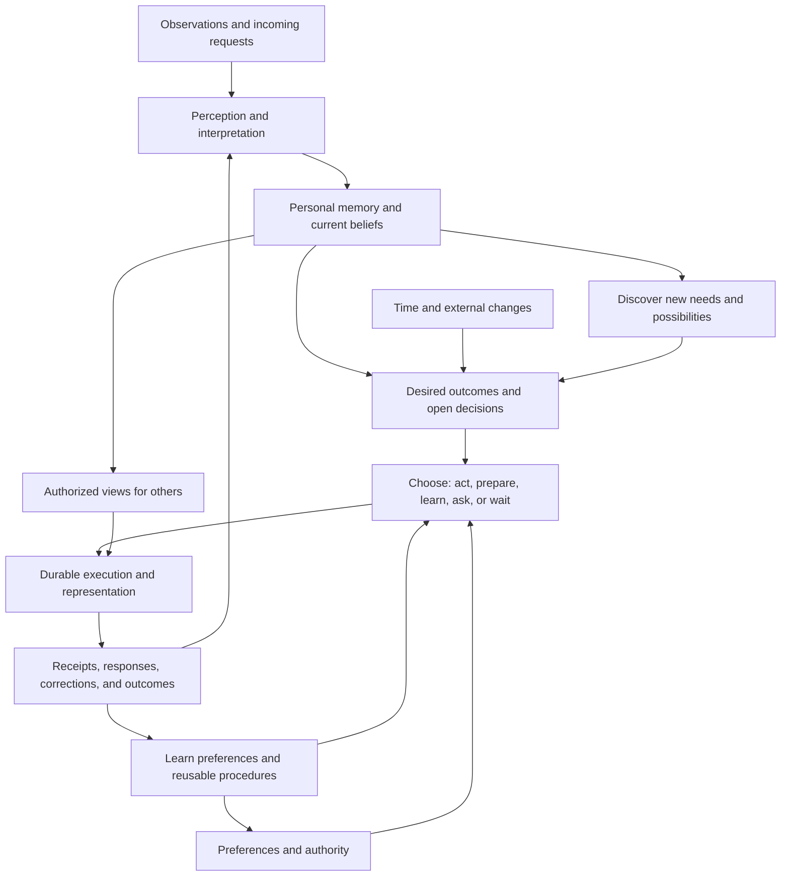

**SuperTwin from scratch: a system for personal understanding and action**

Design proposal — 19 September 2026.

The only product premise used here is: “SuperTwin is your AI twin. It observes and remembers everything about you, finds what needs doing now and in advance, does it the way you would before you ask, stands for you to other people and to their agents, and turns what you consume into taste that others can draw on.” The design does not inherit the existing implementation, feature taxonomy, storage layout, or interface.

Everything below is a proposed design choice. Model capabilities are distinguished from architectural hypotheses; no performance or product outcome has been measured.

**The system I would build**

I would build a continuously updated model of a person's life, connected to a durable system for choosing and carrying out actions. Its basic unit of work would be a desired outcome: something the person wants to happen, something they have undertaken to do, or something the twin tentatively believes would help them.

An outcome survives across conversations, applications, delays, and individual model calls. It has evidence, dependencies, a current status, possible next actions, and conditions that should cause the twin to reconsider it. A conversation is one way to interact with this system; a message is one kind of evidence entering it.

Cheap decision models make frequent, narrowly scoped interpretation economically plausible. I would therefore use them throughout the ongoing control loop, while keeping generation available for understanding unfamiliar situations, inventing plans, and communicating. The design depends on the distinction between decision and generation, not on Jev remaining the best provider.



The boxes are logical responsibilities. I would initially implement them as modules around one durable runtime, rather than deploy a separate service for each box.

**1. Observe broadly; preserve the meaning of the source**

Capture would combine connected services, device activity, documents, media, explicit user statements, and the twin's own action receipts, wherever access has been granted. Adapters would emit a common observation envelope containing source identity, source item ID, author, observation time, event time, content or a content reference, access scope, and revision/deletion information.

The first processing stage would deduplicate, normalize, and perform necessary OCR, transcription, or media interpretation. It would avoid repeatedly interpreting an unchanged screen or re-imported message. Non-text understanding remains a perception job: Jev's current inputs are text. [Model reference](https://docs.typesafe.ai/models).

The system would keep a coverage record: which source was connected, what dates are available, when synchronization last succeeded, and which channels remain inaccessible. This is necessary for honest reasoning. “I found no confirmation” cannot become “there was no confirmation” when a relevant channel is missing or stale.

Capture would run near the device. Continuous full-quality media upload would not be the default implementation of “everything.” Change detection, local extraction, compression, and selectively retained originals would preserve useful evidence within bandwidth, storage, and battery limits. The user would be able to inspect the actual coverage and retention behavior.

**2. Store evidence, beliefs, preferences, and commitments separately**

Memory would have several explicit record types:

| Record | Meaning | Example |
| --- | --- | --- |
| Observation | Something a source actually contained or an action actually returned | A message says “I can do Thursday” |
| Belief | An interpretation supported by observations | Thursday is probably acceptable to that person |
| Desired outcome | A state the user wants, has committed to, or may benefit from | Arrange dinner with these people |
| Commitment | A promise or agreement with identified parties and status | The restaurant accepted a reservation |
| Preference | A contextual tendency or explicit instruction | Quieter restaurants when meeting this friend |
| Authority | The actions and disclosures the twin may perform | Arrange this meal within specified limits |
| Procedure | A reusable way to achieve an outcome | Find availability, propose options, confirm, record receipt |
| Action record | What the twin attempted and what is known to have happened | Reservation submitted; confirmation still missing |

Every consequential interpretation would retain supporting evidence and the time interval for which it applies. A later correction could supersede a belief without making the earlier observation disappear. Contradictory reports could coexist while the system resolves them. Identity links between similar names would be hypotheses until supported.

For each belief, I would track source reliability, semantic uncertainty, freshness, and unresolved contradictions separately where they affect decisions. One confidence number cannot represent all those concerns. Model probability would be a measurement to calibrate, not a certificate of truth.

Storage would use a relational source of truth with temporal records and explicit links, an object store for retained source material, and derived full-text/vector indexes. A graph is a useful logical view; it does not require a graph database at the start. Structured queries handle exact counts and time windows, while semantic retrieval supplies relevant context. Summaries help retrieval but remain derived views linked to sources.

User deletion and changed access rights would propagate to source material, derived records, indexes, caches, and shared views. Event history would support replay within retention policy; it would not create an undeletable archive.

**3. Interpret changes using the cheapest suitable method**

A new observation would first be associated with relevant people, outcomes, objects, and situations through identifiers, retrieval, and learned matching. For known situations, the interpreter would ask bounded semantic questions:

- Is this an acceptance, rejection, tentative suggestion, or unrelated statement?
- Does it satisfy a named prerequisite?
- Does it contradict the proposed fact?
- Does it refer to one of these existing people or outcomes, or none of them?
- Is the source describing something accomplished or something intended?

Jev-like models would answer these questions with explicit alternatives and distributions. Code would apply the resulting state changes only after validating completeness and consistency. Independent questions with shared evidence would be batched.

When a value is present literally, code would extract candidate spans and a decision model could choose the appropriate candidate. For new entities, novel commitments, narrative understanding, or relationships not already represented, a generative model would propose records with evidence references. Both paths would write through the same validation contract.

This allocation avoids forcing a closed-choice model to invent an answer absent from its candidate list. TypeSafe explicitly documents bounded extraction and the need for generation when the answer space is open. [Pre-parsed extraction](https://docs.typesafe.ai/cookbooks/pre_parsed_value_extraction_cookbook), [Model limitations](https://docs.typesafe.ai/model-jaggedness/jev-1.13).

**4. Keep open decisions alive and recompute only what changed**

For each desired outcome, the runtime would maintain open decisions. A decision record would contain:

```text
Question and intended outcome
Relevant evidence and current state versions
Candidate answers/actions, including unknown or no suitable option
Semantic evaluations and observed calibration
Applicable preferences and authority
Decision result and its rationale/evidence
Dependencies, expiry, and next wake condition
Verification required before acting
```

Suppose the twin is arranging a dinner. Whether it can confirm depends on the participants' availability, venue availability, budget, and the user's authority grant. An unrelated document edit should not rerun that decision. A participant withdrawing, a venue reply, a relevant preference change, or the hold expiring should.

The scheduler would invalidate affected decisions when their dependencies change, gather the minimal relevant context, and evaluate them again. It would also support time-based wakeups and policy-compliant external checks. A change to permission must invalidate prepared actions as well as future plans.

This is where low-cost semantic decisions alter the architecture: the twin can maintain many live conditions instead of reconstructing its entire situation in a large prompt each time. The number of evaluations scales with relevant changes and active dependencies, rather than every observation multiplied by every possible question.

The runtime would use a versioned evaluation specification, explicit deadlines, failure/unknown results, and bounded retries. No missing answer would imply success. Results from related heads can conflict; application logic would resolve or defer these conflicts rather than multiplying probabilities as though all heads were independent evidence.

**5. Discover needs outside the current list of questions**

An anticipatory twin cannot rely solely on recognizing familiar labels. It must sometimes notice that its present goals or questions are incomplete.

I would use two complementary processes:

- Frequent maintenance of known outcomes, dependencies, and expected events, using code and decision models.
- Generative exploration when observations introduce unfamiliar situations, repeated friction, unresolved clusters, or significant change, plus budgeted periodic review of material the first process classified as unimportant.

Exploration would ask: What newly matters? What might prevent something the user cares about? Is there an opportunity they would plausibly value? What relevant question have we failed to ask? It would propose new outcomes, relationships, and decision specifications with supporting evidence.

An inferred desired outcome would be distinguishable from an explicit user goal or an actual promise. Proposing an outcome would not automatically authorize acting on it. The twin could gather information or prepare work within its existing scope while it learns whether the inference is right.

Low confidence would be one trigger for exploration, but not the only trigger. A classifier can be confidently wrong or fail to imagine a missing category. Sampling apparent negatives and reviewing missed opportunities are essential to avoid a system that only sees what it already knows how to classify.

**6. Anticipate by reasoning about prerequisites, forecasts, and timing**

For a meaningful outcome, the planner would work backwards from success: which conditions must hold, which depend on other people or external systems, what could change, and when delay starts to matter.

For example, arranging a meal involves more than noticing a deadline. Participants need compatible availability; a venue must suit the group's constraints; availability may disappear; travel time may make a nominally free slot unusable. The twin should know what is settled, what remains uncertain, and the next point at which action becomes useful.

Generative models would construct unfamiliar plans and candidate failure scenarios. Code would handle exact schedules, budgets, and dependencies. Predictive models could estimate response delays, cancellation likelihood, or likely user satisfaction once suitable data exists. Semantic models would evaluate whether new evidence changes those estimates or satisfies a condition.

Predictions would remain marked as predictions. Forecasts of other people's responses are not evidence that they have agreed. Missing observations should lead to an information-gathering action when worthwhile, rather than false certainty.

**7. Make personal action selection explicit**

At a decision point, the twin should be able to act, prepare, gather more information, ask the user, wait for a defined trigger, or abandon a tentative opportunity. The controller would choose among eligible actions based on expected benefit to this person, urgency, likely success, cost, interruption burden, reversibility, and uncertainty.

Authority is a hard eligibility condition outside this ranking. High predicted user satisfaction cannot compensate for missing permission. Likewise, existing commitments and resource conflicts constrain candidate actions before preferences rank them.

The personal model would predict choices conditional on circumstances. Someone may prefer convenience for routine errands, economy for a long holiday, and a particular communication style with one colleague. An action policy needs those distinctions; a global “likes convenience” label is insufficient.

Initially, explicit statements, examples, and general priors would support choices. With feedback, a lightweight per-user ranker or predictor could learn which eligible options tend to satisfy the user. Jev could supply semantic features to that predictor, but the learned preferences would live in SuperTwin and remain portable. TypeSafe's feature-discovery cookbook demonstrates using semantic outputs as inputs to a separate supervised model. [Feature discovery](https://docs.typesafe.ai/cookbooks/autoresearch_feature_discovery).

Corrections would be especially valuable: “Good choice, wrong timing,” “Use this tone with them,” and “I was buying that for someone else” teach different things. Silence, clicks, consumption time, and the twin's own earlier guesses are weak or ambiguous signals. Inferred preferences should decay or change with evidence; explicit instructions retain their identified status until revised.

I would optimize for outcomes the user values and reductions in unwanted effort or regret. Engagement alone is a poor target for a system that should often finish work without requiring attention.

**8. Execute as durable work with verifiable results**

Each proposed operation would have a typed action contract: target, arguments, expected result, relevant authority, prerequisites, state version, expiry, and verification method. The executor would choose an available API, application integration, or interactive tool appropriate to that action.

A durable workflow would record proposal, admission, dispatch, acknowledgment, verification, and any failure or ambiguity. It would resume after interruption and reconcile uncertain operations before retrying. Use external idempotency keys when supported; otherwise check whether a consequential operation already happened. Do not promise exactly-once execution across services that cannot provide it.

Before an external action, recheck mutable state: permissions, recipient identity, current price, availability, and conflicting actions. A prepared plan is not permanently valid. Coordinate across devices so two workers do not independently perform the same operation.

Semantic verification can check whether a reply means acceptance, but objective receipts and external status are stronger evidence for many actions. A model saying “I completed it” is insufficient. The result must update both the action record and the underlying desired outcome appropriately.

Some work can be prepared freely within granted scope; other actions require a standing mandate or a specific user decision. As trust develops, the user can grant more precise mandates. The system learns how to use authority well; it does not learn new authority from successful prediction.

**9. Represent the person through controlled views of the same memory**

Representation would use the same beliefs, preferences, and commitments as personal assistance, with a view constrained to a particular counterparty and purpose.

For a human, the twin would communicate as an identifiable representative, using the user's contextual style preferences and the information it is permitted to share. For another agent, it could exchange structured requests, proposals, counteroffers, acceptance, cancellation, and completion evidence. Human-language channels remain available; adoption would not require a universal agent protocol.

A representation scope would specify whose interests the twin represents, which facts it may disclose, what terms it may negotiate, which commitments it may make, and when that authority expires. Proposal and acceptance would have explicit identities and references, so an incoming suggestion cannot silently become an agreement.

An external agent's message is evidence about that agent's request or claim. It is not an instruction that can rewrite the owner's goals or permission policy. Identity verification, access checks, and authority validation belong to the communication/execution boundary.

The information exposed should be what the counterpart needs: for scheduling, possibly “these slots work,” without disclosing the private reasons other times do not. Authorized derived views and explanations must inherit restrictions from the information they use.

**10. Turn consumption into grounded, shareable taste**

Taste would develop through a dedicated interpretation of interactions with content, products, places, and experiences. Reading, saving, recommending, buying for oneself, buying as a gift, trying, revisiting, and explicitly disliking something are different observations.

Decision models could label relevant characteristics and context. The personal predictor would learn combinations and tradeoffs: which qualities matter to this user, in which circumstances, and how strong the evidence is. A generative model could express the resulting preference in useful language or explain a recommendation.

The result should be queryable judgment: “What would this person recommend for this occasion, under these constraints?” A selected public or shared taste view could answer that without exposing private source history. A recipient could also supply their own constraints so the recommendation transfers the useful part of the person's judgment rather than blindly copying a ranking.

I would preserve distinctions between personally experienced, explicitly endorsed, tentatively inferred, and merely encountered. A long video watch or repeated exposure alone does not establish approval. The user should be able to correct a taste inference and control which domains or recommendations become available to others.

Taste and action planning would reinforce one another through real outcomes. A recommendation the user later enjoys supplies stronger evidence than an untested prediction. The twin's own recommendation must not count as independent evidence of the user's preference.

**11. Allocate models by job, with evidence-based routing**

| Computation | Default responsibility |
| --- | --- |
| Exact logic | Code: identity keys, arithmetic, budgets, permissions, scheduling, invariants |
| Perception and search | Appropriate local or hosted OCR, ASR, multimodal models, embeddings, retrieval |
| Bounded semantic interpretation | Jev-like decision model, or a local classifier when it passes evaluation |
| Open-ended understanding and generation | Cheapest generative model that satisfies that job's measured requirements |
| Novel or difficult planning | Stronger reasoning model when needed |
| Personal choices and useful timing | Learned preference/prediction models, initially backed by explicit rules and priors |
| External changes | Durable workflow and tool execution, with observable verification |

Every decision/generation request would identify its task specification, permissible data scope, context, deadline, quality requirements, and budget. Model selection first filters for eligibility, then considers cost and measured performance. This allows the cheapest suitable generative model to win a classification job if it actually performs better overall.

I would start with static model choices per evaluated job and explicit fallbacks. Later, an outcome-trained router could predict which eligible model meets the quality target. A router's confidence in the word “cheap” is not the probability that another model's future output will succeed.

For unfamiliar operations, verification and occasional stronger review remain available. For stable repetitive decisions with enough labels, replace hosted inference with a validated small local model or exact rules where appropriate. Reusable procedures can similarly turn repeated successful plans into checked workflows. Generative proposals for rules or workflows must pass validation and replay before promotion; they cannot modify core authority rules.

**12. Physical architecture and operation**

My default deployment would combine device capture with an always-available private runtime, so the twin can receive responses and manage commitments while a phone or laptop sleeps. Devices would retain sensitive originals where useful, perform local preprocessing, and synchronize selected encrypted records. Hosted processing necessarily receives the authorized material it must compute on; encryption at rest is not a claim that a running model cannot see its input.

The hosted runtime would multiplex users on shared infrastructure with strict data isolation. Each person has ordered state transitions and coordinated action ownership; this does not require a dedicated VM. CPU logic, model requests, external I/O, and long-running waits would use separate bounded queues so a slow bulk import does not delay an active negotiation.

The initial implementation needs a transactional database, object storage, derived search indexes, a durable queue/scheduler, a model gateway, and tool adapters. Keep these as a small set of deployable components. Logical boundaries should be clear before operational complexity grows.

Historical imports rebuild memory but do not automatically enact old requests. A separate freshness check decides whether a historical finding describes a still-open present need. Connector outages, model outages, quota exhaustion, and uncertain external actions become explicit states, not silent disappearance.

The runtime should support replay without external side effects. Evidence and model versions allow us to reconstruct why a decision occurred; a separate execution mode prevents a replay from resending messages or repeating bookings. Forgetting and access revocation must invalidate dependent jobs as well as data views.

**13. Economics and evaluation from the beginning**

The primary efficiency mechanism is doing less redundant work: capture changes once, process relevant deltas, reuse versioned context, batch shared questions, and suspend decisions until their dependencies change. Avoid evaluating every question against the complete life history.

For illustration only, 100 Jev batches per day at 2,000 total input tokens each for 30 days would consume 6 million tokens, or $0.252 at the currently listed $0.042/M input price. That excludes generation, perception, storage, network activity, retries, and tools. It is an arithmetic illustration, not a usage forecast or total per-user cost estimate. [Pricing](https://docs.typesafe.ai/models).

Model budgets would track all those categories separately. Measure cost per correctly resolved decision and successfully completed desired outcome, including fallback and repair. A cheaper classification call that causes costly mistakes can lose on the product's actual objective.

Evaluation would cover understanding accuracy and open-world discovery recall, contextual preference prediction, false commitments, stale-state actions, duplicate execution, successful recovery, and verified completion. It would also measure unwanted interruptions, correction burden, coverage gaps, multilingual performance, and taste recommendations grounded in the right kind of experience.

Calibrate each decision family on held-out outcomes. Test correlated and contradictory judgments; never assume independent per-head confidence gives calibrated workflow confidence. Novelty and candidate-retrieval misses require separate measurements because a model cannot select an absent option.

**14. How I would begin building**

I would first implement the common observation/memory/decision/action contracts and prove three complete scenarios:

1. An observed commitment is remembered, tracked across changing evidence, acted on under a narrow mandate, and closed only with sufficient confirmation.
2. A desired future outcome generates useful preparation before a direct request; a changed condition causes appropriate replanning or cancellation.
3. A real experience updates contextual taste, supports an authorized recommendation to someone else, and improves after feedback.

These exercise remembering, anticipation, execution, representation, and taste using the same core. They should include outages, ambiguity, corrections, and permission changes before adding large numbers of integrations.

The first evidence of success should be a complete useful outcome with an understandable trace and little corrective effort. Add breadth after that loop works. Introduce learned predictive routing only when the system has produced enough labeled decisions to establish that it improves the cost/quality tradeoff.

The architectural bet is that frequent bounded judgments can keep a rich personal state and many intentions current, while generative reasoning supplies the open-ended imagination, planning, and language those judgments cannot provide. The system's lasting value would live in its evidence, contextual personal model, reliable execution, and learning from outcomes; any individual model remains replaceable.
